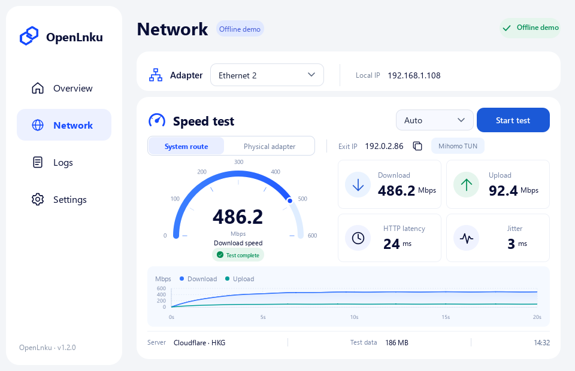

<p align="center"></p>
<h1 align="center">OpenLnku</h1>
<p align="center">A clearer way to connect.</p>
<p align="center"><a href="https://github.com/SophonTrace/OpenLnku/releases/latest">Download for Windows</a> · <a href="README.md">简体中文</a> · <a href="LICENSE">AGPL-3.0</a></p>

OpenLnku is a modern Windows network authentication client built with C++20 and Qt Quick. Its blue and white interface brings connection status, adapter binding, traffic and speed tests into one clear view.

The current protocol configuration targets the JLU campus network (DrCOM). This independent project is not affiliated with the university or the official client. Compatibility with other networks requires protocol and parameter verification.



*Captured from the actual application using offline demo data. The image does not represent a live authentication or speed-test result.*

## Features

- Select a physical adapter and bind authentication to its interface and IPv4 address.
- Confirm authentication and heartbeat responses before reporting a connection.
- Reconnect with backoff after failures; rebuild the session after suspend and resume.
- Start with Windows and connect automatically using saved credentials.
- Test the system route or the selected physical adapter, with automatic, domestic and overseas server selection.
- View exit IP, download and upload speeds, HTTP latency, jitter, live charts and test data usage.
- Monitor adapter throughput and cumulative traffic for the current application session.
- Switch instantly between Simplified Chinese and English; control the connection from the Windows tray.
- Protect saved passwords with current-user DPAPI and verify signed update manifests and archive hashes.

## Getting started

Download the installer or portable ZIP from [Releases](https://github.com/SophonTrace/OpenLnku/releases/latest). Windows 10+ x64 is supported; administrator privileges are not required.

1. Fully exit other authentication clients to free UDP port 61440.
2. Select the physical network adapter on the Network page.
3. Enter your account and password, then connect.
4. Closing the window normally keeps the client in the tray. Disconnect or choose Exit to end the session.

Start with Windows, automatic connection and automatic reconnection are enabled by default for new users. Existing explicit preferences are preserved. Manual disconnection pauses recovery until you connect again. Saved passwords are encrypted for the current Windows user; unchecking Remember password or clearing the account removes them.

Authentication uses UDP 10.100.61.3:61440. Binding the interface does not change global proxy settings. Traffic counters include all system traffic through the selected adapter and reset when the application restarts. Speed measurements use bounded, single-connection HTTPS transfers, not the official Ookla or Cloudflare algorithms, and may not saturate your access link.

## Upgrades and removal

Exit the tray client before installing an upgrade. The installer preserves the existing path, account and preferences, removes obsolete managed files and keeps unknown user files. OpenNex installations and preferences are migrated to the OpenLnku identity. Uninstalling preserves preferences by default; choose the purge option to remove them.

The in-app updater verifies an ECDSA P-256 signature using the embedded public key, then verifies the archive SHA-256. Applying an update backs up managed files and rolls back on failure. Interrupted updates can be recovered from Settings. Update signing is distinct from Windows Authenticode signing; the EXE and installer currently do not carry an Authenticode certificate.

## Build and license

Use Visual Studio with the C++ workload, Windows SDK and Qt 6.8.3 MSVC x64. Release scripts require PowerShell 7.4+. Set QT_ROOT if Qt is outside the default `.deps/Qt/6.8.3/msvc2022_64` path.

```powershell
./tools/build.cmd
./tools/package.ps1
./tools/verify-package.ps1
./tools/installer.ps1
./build/OpenLnku.exe --demo --language en
```

`--demo` uses synthetic responses, creates no authentication UDP socket and does not write real startup settings. Preview and fixture switches are restricted to demo mode.

OpenLnku is released under AGPL-3.0. Protocol references and third-party notices are recorded in [THIRD_PARTY.md](THIRD_PARTY.md). Packages include source code and Qt license materials; dynamically linked Qt libraries can be replaced. Never commit or distribute the publisher's private signing key.
