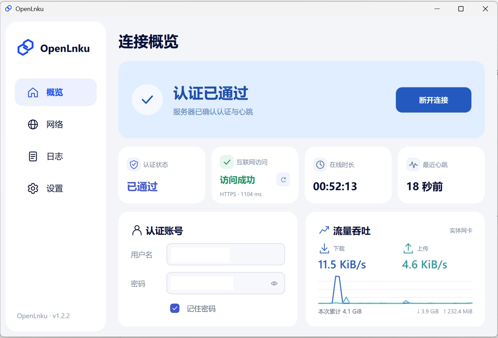
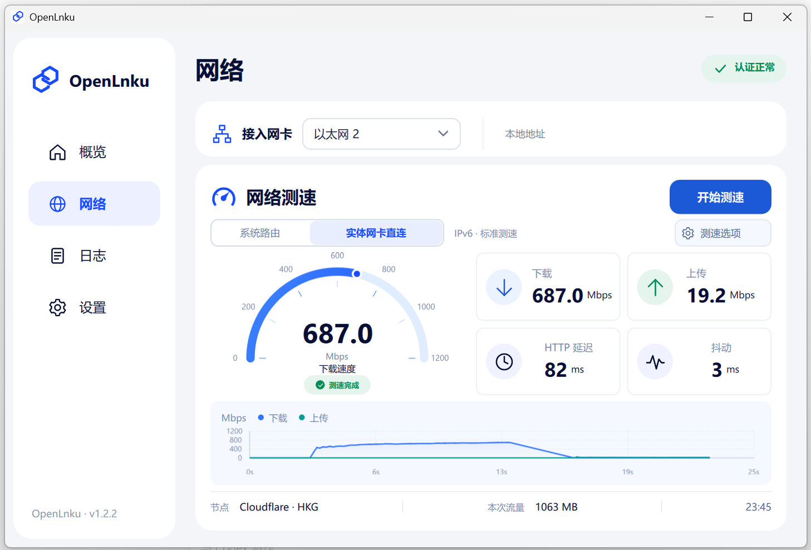
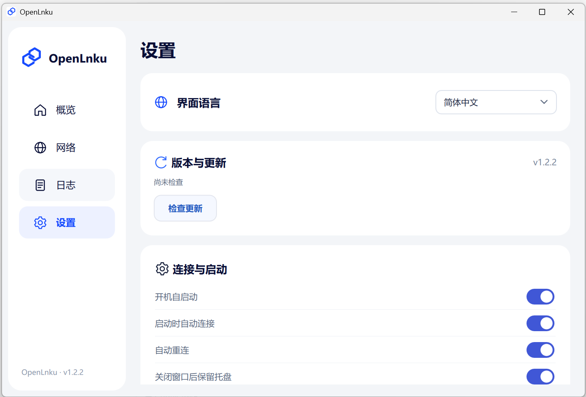

<h1 align="center">OpenLnku</h1>

快速连接，断线自动重连。

<a href="https://github.com/SophonTrace/OpenLnku/releases/latest">下载 Windows 版</a> · <a href="README.en.md">English</a> · <a href="https://github.com/SophonTrace/OpenLnku/issues">反馈问题</a>

OpenLnku 是一款现代化UI的 Windows 校园网认证客户端。下载客户端，自动识别网卡，输入账号密码，即可自动连接。开机自动启动，网络中断或电脑休眠自动重连恢复认证，无需管理员权限，可实时查看认证状态和流量，集成了网络测速功能。

目前支持 **吉林大学校园网（JLU / DrCOM）**。

*实际使用截图，账号、密码栏与网络地址已遮挡。*

## 主要功能

| 功能 | 说明 |
| --- | --- |
| 现代化UI界面 | 现代化UI界面，自适应高分辨率屏幕 |
| 选择与绑定网卡 | 选择实际接入校园网的网卡，绑定该网卡进行认证 |
| 断线自动重连 | 网络中断或电脑休眠唤醒后，自动重连恢复认证 |
| 开机自启动 | 随 Windows 启动，启动后自动建立连接 |
| 网络测速 | 下载、上传、HTTP 延迟、抖动和速度曲线 |
| 测速路径 | 可切换系统路由与实体网卡直连 |
| 测速选项 | 自动／国内／海外节点，自动／IPv4／IPv6 协议，标准／延长测速 |
| 出口信息 | 查看国家、出口 IP、服务商、位置与时区 |
| DNS 检测 | 查看检测服务实际观察到的 DNS 解析器及归属信息 |
| 流量统计 | 查看所选网卡的实时吞吐和本次运行累计流量 |
| 托盘 | 托盘可选择连接、断开、退出 |
| 应用内更新 | 在设置中检查、下载新版本 |

## 下载与使用

支持 **Windows 10 / 11，64 位**。日常运行无需管理员权限。

1. 在 [Releases](https://github.com/SophonTrace/OpenLnku/releases/latest) 下载安装包，或下载便携 ZIP 并完整解压。先从托盘完全退出其他认证客户端。
2. 打开 OpenLnku，在“网络”页面选择接入校园网的网卡。
3. 在“概览”填写账号密码，点击“连接”，等待“认证已通过”。

新用户默认开启开机自启动、自动连接和断线重连，可在“设置”中调整。自动连接需要保存账号密码；手动断开后，自动重连会暂停，直到再次点击连接。

点击窗口右上角的关闭按钮，应用会继续在托盘运行。需要完全退出时，在托盘菜单选择“退出 OpenLnku”。连接后不会弹出校园网资讯页面。

## 测速怎么选

**系统路由**用于查看当前 Windows 网络路径的表现，包括系统代理或 TUN。**实体网卡直连**通过所选实体网卡测速。

点击“测速选项”可调整节点、IP 协议和时长：

- **自动节点**：自动根据ip出口选择相应节点，节点不可用时尝试另一类。
- **国内／海外节点**：国内使用上海大学测速服务，海外使用 Cloudflare。
- **IP 协议**：可选自动、IPv4 或 IPv6。两种协议的线路可能不同，可以分别测试。
- **测速时长**：标准下载 10 秒、上传 7 秒；延长下载 20 秒、上传 15 秒。

测速会产生网络流量，面板显示本次消耗。

## 出口与 DNS 检测

出口信息展示当前测速路径访问查询服务时的公网 IP，并提供近似地区、服务商和时区。

DNS 检测支持系统 DNS 和所选网卡配置的 DNS。

出口查询和 DNS 检测使用 Cloudflare / IPLeak 在线服务，服务端可观察到查询出口或 DNS 解析器地址。

## 账号、更新与卸载

- 保存的密码使用 Windows 当前用户的数据保护机制加密。取消“记住密码”或在设置中清除账号，即可删除保存的密码。
- 在设置中检查应用更新，按提示下载并重启更新。手动安装升级前，请先从托盘退出旧版。
- 原 OpenNex 用户的账号和设置会自动迁移。
- 卸载默认保留账号和设置，也可在卸载时选择一并清除。
- 当前程序及安装包尚无 Windows 代码签名证书。

流量统计包含所选网卡上其他程序的流量，从本次打开应用开始累计，重启后重新计数。

## 常见问题

**无法认证连接？** 完全退出其他认证客户端，确认解除61440端口占用，检查接入网卡、账号密码和网线和Wi-Fi 状态。日志页面可导出记录供排查。

**IPv4 和 IPv6 测速差很多？** 两者可能使用不同线路，节点和代理规则也会影响结果。选择相同路径、相同节点分别测量，必要时启用延长测速。

## 反馈与开源

欢迎通过 [Issues](https://github.com/SophonTrace/OpenLnku/issues) 反馈问题，请附上应用版本、Windows 版本、接入方式和复现步骤。

本项目采用 [AGPL-3.0](LICENSE)。第三方来源与许可见 [THIRD_PARTY.md](THIRD_PARTY.md)；需要自行构建时，可阅读 [构建说明](docs/BUILD.md)。
